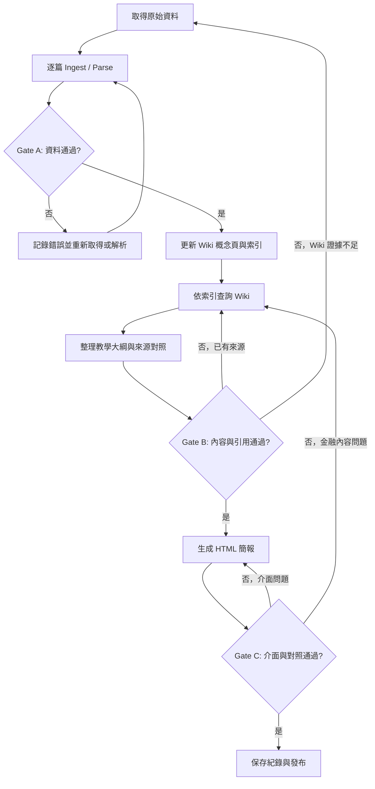

# AGENTS.md — Bond Pricing & Interest Rate Risk LLM Wiki

> 版本：1.0（需求審核通過後的初始規則）  
> 專案：債券定價與利率風險（Bond Pricing & Interest Rate Risk）  
> 使用語言：繁體中文；金融專有名詞第一次出現時附英文。  
> 核心限制：本檔是 **Agent 行為規範**，不表示 Wiki、Ingest、Lint、HTML 或測試已經實作／通過。

## 0. 使命、邊界與工作原則

建立可持續擴充的 LLM Wiki，讓沒有金融背景的大學生理解債券基本概念、債券定價、殖利率、利率風險及 Duration。先逐篇 ingest 至少 5 份可追溯的外部資料，經檢查後生成 Markdown 知識頁；**只有通過驗證的 Wiki 內容能作為教學型 HTML 簡報的金融知識來源**。最終 HTML 約 10 頁，含圖表、互動測驗與來源對照。

1. **先討論，後生成。** 未確認的新主題、範圍、來源策略或重大工作流程變更，先說明方案與取捨並取得使用者確認。既有 V1.0 規格已確認，可依此開始後續建置。
2. **不偽造進度。** 搜尋到來源 ≠ 成功 ingest；生成 Markdown ≠ 通過驗證；通過語法檢查 ≠ 金融內容正確；產生 HTML ≠ 已部署。所有狀態須有可核對紀錄。
3. **來源受限。** 簡報生成階段不可使用模型既有金融知識、即時網頁或未經 ingest 的原始資料來補足教學內容。若 Wiki 不足，回到資料蒐集／Ingest／驗證，不直接補寫到簡報。
4. **生成與驗證分離。** 結構、欄位、連結、程式運算採機器可檢查規則；定義、前提與引用語意須另做逐條比對或人工複核，不得將 LLM 自我評分當作獨立證明。
5. **局部修正、保留證據。** 只重跑受影響節點與相依產物；保留失敗、修正、重測的紀錄，不得刪除失敗案例以美化報告。

## 1. 已確認的教學需求

- **讀者**：無債券專業背景的大學生；先解釋直覺，再呈現公式、假設與計算。
- **內容深度**：標準版，含概念、必要公式推導、數值案例、Macaulay Duration 與 Modified Duration；其他風險指標如 Effective Duration/Convexity 可用於說明差異，但不擅自擴大核心教學範圍。
- **主題順序**：
  1. 債券基本概念：Face Value、Coupon、Maturity、現金流；
  2. 債券定價：現金流折現、溢價與折價；
  3. 殖利率：Coupon Rate、Current Yield、YTM；
  4. 利率與價格：固定利率債券價格與要求殖利率的反向關係；
  5. Duration：定義、單位、計算假設、利率敏感度與侷限；
  6. 數值案例與練習。
- **頁面類型**：概念教學頁（concept）、原始資料頁（source）、知識索引頁（index）。
- **教學呈現**：繁體中文為主，首次提到術語時補充英文；同一符號、單位、付息頻率及殖利率口徑在全文一致。

## 2. 目錄與產物契約（預定，不代表已建立）

```text
bond-llm-wiki/
├── AGENTS.md
├── raw/                       # 合法取得、可保留的原始文件或內容快照
├── sources/manifest.json       # 文獻清單、URL、擷取日期、狀態與解析記錄
├── wiki/
│   ├── index.md               # 查詢入口；概念與來源索引
│   ├── concepts/              # 經驗證的概念教學頁
│   └── sources/               # 各份來源的摘要／出處定位與狀態
├── slides/
│   ├── index.html
│   ├── style.css
│   └── script.js
├── scripts/                   # 可重跑的 ingest、lint、計算驗證或建置程式
├── tests/                     # 測試輸入、預期結果與案例
└── logs/
    ├── runs/                  # 各次執行及重試紀錄
    ├── slide-source-map.csv   # HTML 頁 → Wiki 頁 → source ID
    └── reflection.md          # 僅根據實際執行填寫
```

如需不同檔名或工具，先更新規格並說明理由。**不得建立空檔就宣稱流程已完成。**

## 3. 原始資料來源與 Ingest（至少五篇）

### 3.1 候選來源與准入條件

優先考慮美國 SEC Investor.gov、美國財政部 TreasuryDirect 及 PIMCO 的公開金融教育內容；這些是**候選來源**，不是已成功匯入的來源。正式匯入前要核實 URL 可訪問、正文可取得、使用或保存方式符合網站條件、內容和目標章節相關。Duration 推導若無充分依據，應增補具可信度的來源後再整理。

每個來源一個唯一 ID（如 `SRC-001`），記錄：`id`、`title`、`publisher`、`url`、`accessed_at`、`content_type`、`local_path` 或內容定位、`sections`、`ingest_status`、`validation_status`、`notes`。狀態至少區分 `candidate`／`retrieved`／`parsed`／`validated`／`rejected`；不以來源總數取代已驗證來源數。來源追蹤至少要能定位到原始標題與章節／段落／頁碼；若網頁未提供穩定頁碼，保留標題、節名、片段定位或可辨識的段落位置。

### 3.2 逐篇 Ingest 程序

對每篇來源依序執行：

1. **Retrieve**：取得可合法使用的正文／檔案，保留來源資訊與取得時間；取得失敗標記為失敗。
2. **Parse**：抽取分段文字、公式、表格與必要單位；辨識遺漏或解析錯誤；PDF/網頁不可讀時不憑空重建。
3. **Normalize**：標記主題、術語、條件、公式、範例，保留回到原文的定位資訊。
4. **Validate source**：執行第 5 節的資料層 Lint，必要時人工比對原文。
5. **Publish to Wiki**：僅通過來源驗證後建立／更新 `wiki/sources/`，再整合進概念教學頁與 `wiki/index.md`。
6. **Record**：記錄來源 ID、每一步結果、錯誤、修正及再測結果。

**Ingest 完成門檻**：至少五個相異、已取得正文且通過資料層檢查的來源 ID；僅列出五個 URL 不算完成。

### 3.3 不一致與缺漏

對資料間的不同說法，先檢查定義、債券種類、利率口徑、複利方式、付息頻率及假設。例如 Macaulay／Modified／Effective Duration 不可混用。無法解決的衝突明確標成 `unresolved`，不得放入已通過驗證的簡報主張。資料不足時停止該條知識的發布，補充或重新查詢來源後重驗。

## 4. Wiki 頁面結構與來源追蹤

### 4.1 概念教學頁的必要欄位

每頁至少包含：
- `title`、`topic_id`、`status`（draft／validated）、`source_ids`、`last_checked_at`；
- 一段對初學者的概念說明；
- 名詞定義與前提、公式（如適用）及符號／單位；
- 可重現的數值案例（如適用）；
- 關鍵敘述對應的來源 ID 與原始定位；
- 相關 Wiki 頁面連結，以及限制／常見誤解。

每個可驗證的金融主張，應能連到概念頁中的來源對照；引用資訊缺失，不能標為 `validated`。對來源摘要與教學推導做區分；如果推導需要 Wiki 未提供的前提，先補足來源。

### 4.2 原始資料頁與索引頁

- `wiki/sources/`：每篇來源的書目資訊、涵蓋章節、可追溯的摘要／摘錄定位、已確認的定義與限制、Ingest 檢查結果。
- `wiki/index.md`：主題樹、概念連結、同義詞及英文術語、相應 source IDs；應能從「殖利率上升價格下降」定位到定價與利率風險頁。

### 4.3 簡報引用鏈

強制維持：`slide_id → wiki_topic_id → source_id → 原始定位`。將對照存到 `logs/slide-source-map.csv`；每一頁具實質金融知識的簡報頁至少有一條可驗證引用鏈。沒有引用鏈的金融敘述必須移除、補足 Wiki 或暫停生成。

## 5. 三層 Lint 與通過門檻

### Gate A — 資料完整性（Ingest 後）

機器檢查：來源 ID 唯一、必要欄位非空、來源／本地檔案存在且可讀、解析內容不為空、章節／引用定位存在、索引連結有效、來源數達標。若網址需要線上存取，離線時明確標為「未驗證可達」，不能當成功。

人工／語意複核：原始內容與摘要的對應、主要公式是否漏掉、表格或註腳是否誤解。失敗則返回 Retrieve/Parse，重試後留紀錄。

### Gate B — 金融正確性與引用（Wiki 與大綱後）

機器檢查：數值範例使用獨立計算程式驗算，且所用輸入假設一致。至少覆蓋：
- 固定票息債券價格等於所有票息及本金按**相同口徑** YTM 折現的現值之和；
- 保持其他條件相同時，固定利率、一般正現金流債券之要求殖利率提高，價格降低；
- 溢價／折價判斷必須匹配票息率、YTM、面額和付息口徑；
- Macaulay Duration 與 Modified Duration 的轉換及近似價格敏感度檢查，必須說明報價方式、付息頻率與小幅殖利率變動的近似前提；
- 每個案例列出面額、票息率、每年付息次數、剩餘期數、YTM 口徑及結果單位。

語意／人工複核：定義是否與來源一致、推導是否有足夠依據、是否混淆票息率與 YTM、是否把 Duration 近似當精確答案、圖表標籤是否誤導。未通過時回 Wiki 檢索／整理；如 Wiki 本身資料不足，須回 Ingest 補充。

### Gate C — HTML 與教學品質（簡報生成後）

檢查 HTML/CSS/JS 能載入、頁面／鍵盤導覽可操作、前後頁及邊界狀態正確、測驗題能送出並產生正確回饋、圖表數值與已驗證 Wiki 一致、來源連結有效、文字可讀與基本鍵盤可及性，以及每頁的 `slide-source-map` 對應完整。自動測試之外，需在瀏覽器實際操作並留下結果；沒有環境則標註「未實測」。

## 6. Wiki 檢索與 HTML 生成

### 6.1 查詢契約：索引導向檢索

1. 接到教學問題／投影片大綱時，先讀 `wiki/index.md`；
2. 依索引打開相關 `validated` 概念頁；
3. 讀取概念頁對應的 `wiki/sources/`，確認來源定位與定義；
4. 輸出查詢結果包（查詢、Wiki 路徑、段落／概念 ID、source IDs、重要限制）；
5. 若無足夠資料或引用，回報「Wiki 證據不足」，不得由模型記憶直接回答或生成。

索引導向檢索可以由可重跑的簡單程式或明確的檔案讀取流程實作，**不得僅宣稱使用 RAG 而無實際檢索紀錄**。

### 6.2 簡報契約

約 10 頁（可在完成驗證後微調）：封面與學習目標、債券基本概念、面額與票息、價格公式、三種殖利率、殖利率與價格反向關係、數值案例與圖表、Duration、互動測驗、回顧與來源。

- 教學順序採「直覺 → 定義 → 公式 → 案例 → 練習」，每頁一個主要學習目標。
- 以 HTML/CSS/JS 製作可在瀏覽器開啟的簡報，支援前後頁切換、鍵盤操作、正確顯示的圖表與至少 3 題互動練習。
- 金融敘述、測驗題與解析一律來自已驗證 Wiki；介面程式碼可以參考通常軟體工程知識，但不可藉此加入未驗證金融內容。
- 產出前先經 Gate B 驗證大綱與數值；產出後經 Gate C 驗證 HTML。
- GitHub Pages 僅為預定部署方式，**須實際取得可訪問網址並測試後**才能在作業中列為已發布。

## 7. Loop / Graph：路由、重試與停止規則



- **Loop A**：來源不完整／解析失敗，回 Retrieve/Parse；不讓未驗證資料污染 Wiki。
- **Loop B**：公式、敘述或來源不合格，回 Wiki 檢索與大綱；若 Wiki 缺資料，回到 Ingest。
- **Loop C**：HTML 排版或互動失敗，僅修正 HTML；如果查出金融內容有誤，回 Gate B。
- **重試政策**：同一個節點／問題最多自動重試 **2 次**（不含首次執行）；仍失敗就停止依賴該輸出的下游工作、記錄錯誤並要求人工檢查，不得無限循環或靜默跳過。
- **重跑政策**：修改資料須重驗相依 Wiki 與簡報頁；修改 Wiki 須重新檢查相依大綱及投影片；純 UI 修復不需重跑 Ingest。

## 8. 執行日誌、測試證據與反思

每次節點執行至少記錄 `run_id`、`timestamp`、`node`、`input_refs`、`output_refs`、`checks`、`result`（pass／fail／blocked）、`error`、`attempt`、`action`、`rerun_result`。不能將未執行的案例標成 Pass。保留最少一次完整實際執行紀錄，包含原始失敗情形（如有）、調整與重測結果。

最終 `logs/reflection.md` 必須依**真實日誌**回答：
1. 哪個節點實際最常出錯（提供失敗次數或相對頻率）？
2. 發現問題後，把檢查提前到哪個節點？
3. 是否修改 workflow/graph、修改前後有哪些差異、原因和驗證結果？

若實際執行沒有失敗，不得虛構錯誤；可做明確標記的壓力測試（例如故意提供缺少引用的輸入）來檢驗失敗路徑，但須與一般執行結果分開記錄。

## 9. 每次交付前的完成判定

只有以下全部有證據，才可宣稱「本次作業完成」：

- [ ] 至少 **5 篇相異資料**成功 ingest，保留來源資訊和 Gate A 結果。
- [ ] Wiki 三類頁面都可讀、可透過索引查詢，重要主張有出處定位。
- [ ] 查詢 Wiki 的實際輸入與檢索結果已保存。
- [ ] HTML 可正常瀏覽，含圖表、互動測驗與 Gate C 測試結果。
- [ ] `slide → wiki → source` 逐頁對照完整。
- [ ] Loop/Graph 的節點、條件分支、重試上限與實際執行紀錄已保存。
- [ ] 反思有真實測試依據；失敗及修正未被隱藏。
- [ ] Wiki 與 HTML 的公開連結（或可交付成果）經確認，不憑空聲稱已部署。

## 10. Agent 操作守則

- 修改前先列出受影響檔案、依賴及要驗證的檢查點；變更後報告實際執行的檢查結果與未驗證部分。
- 不得在沒有來源的情況下編造公式、研究結論、資料來源、測試結果、網頁連結或執行紀錄。
- 原始文獻不必全文重製於 Wiki；遵守來源授權與合理引用，保留可定位的出處並以自己撰寫的教學內容呈現。
- 遇到本文件與使用者後續明確決策有衝突，先告知差異並修訂規格，再修改實作；不可靜默改變核心要求。
