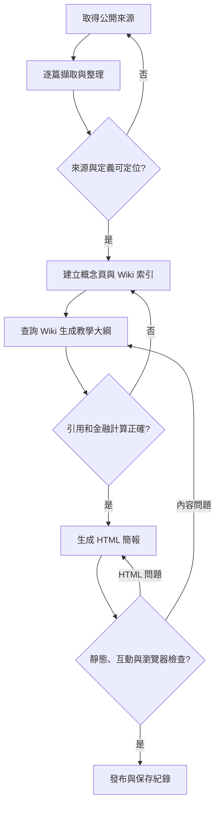

# LLM Wiki × HTML 教學簡報 — 繳交內容草稿

> **狀態**：已完成本地產物及測試紀錄；GitHub Pages 尚未發布，所有網址均為待填欄位。這份草稿請在發布成功並實際驗證後再繳交。

## 1. LLM Wiki 主題與簡短介紹

主題為「債券定價與利率風險」（Bond Pricing & Interest Rate Risk）。我以金融初學者為對象，建立六個主題的 LLM Wiki，包括債券基本概念、現金流折現與定價、票面利率與殖利率、價格與殖利率反向關係、Macaulay / Modified Duration，以及數值案例。Wiki 使用 Markdown 知識索引、概念頁與來源卡，並以 source ID 對應原始資料，讓後續簡報能追溯知識來源。

## 2. Wiki 連結或成果

- Wiki 網址（發布後補入）：`https://<GitHub帳號>.github.io/bond-llm-wiki/wiki/`
- 原始資料整理：8 個來源 ID（公開來源的結構化摘要及來源定位；尚未保存完整全文）。
- Wiki：6 篇概念頁、1 篇知識索引與 8 篇來源卡。
- 檢索方式：由 `wiki/index.md` 查詢相關主題，再讀取概念頁與 source ID，不直接用模型的記憶填補內容。

## 3. HTML 教學簡報連結

- HTML 簡報網址（發布後補入）：`https://<GitHub帳號>.github.io/bond-llm-wiki/slides/`
- 共 10 頁，包含債券現金流、定價公式、YTM 與價格圖表、Duration、三題互動測驗。每頁標記對應的 Wiki topic，對照紀錄位於 `logs/slide-source-map.csv`。

## 4. Loop / Graph 流程

來源檢查、金融內容檢查與 HTML 測試是三個重複檢查點。同類錯誤最多重試兩次，仍未通過就記錄並停止，不把未驗證項目當作成功。

## 5. 一次實際執行與檢查紀錄

- 第一輪 Wiki 查詢：3/3 問題有找到 Wiki 主題與來源 ID（見 `logs/runs/2026-11-14-query-tests.json`）。
- Wiki 來源及基本金融計算 Lint：54/54 項通過（見 `logs/runs/2026-11-14-lint-report.json`）。
- 本地最終靜態、來源對照與公式稽核：48/48 項通過（見 `logs/runs/2026-11-14-final-audit.json`）。
- JavaScript DOM 互動模擬：修正前測試失敗，修正後 12/12 項通過（見 `logs/runs/2026-11-14-interaction-simulation.json`）。
- **未通過／未完成項目：** Chromium 真實瀏覽器環境受到存取政策封鎖，尚不能宣稱完成真實瀏覽器操作驗證；GitHub Pages 尚未發布。

## 6. 反思

在建立 Wiki 時發現 Current Yield 的原始引用不足，原本引用的 SRC-003 未能明確支持定義。因而補入 SEC Investor.gov 的 Current Yield 詞彙頁（SRC-008），並把**來源是否能直接支持敘述**的檢查提前到概念頁生成之前。在 HTML 互動測試時，也發現點擊導覽按鈕後方向鍵失效，修改鍵盤事件的焦點排除條件後，再測 12 項互動模擬均通過。因此，我把 workflow 改為「來源核對 → Wiki 生成 → 內容核查 → HTML 生成 → 互動測試」，在問題進入後續產物前先阻擋，減少重做成本。由於執行樣本有限，目前無法以統計結果確定哪個節點最常出錯；來源對照是我優先前移檢查的節點。

---

**提交前待辦：** 發布 GitHub Pages；實際確認 Wiki 與簡報網址可由其他瀏覽器開啟；測試上一頁／下一頁、鍵盤、圖表及測驗；補上真實測試結果；再依老師要求填寫學校、學號、系級、姓名的標題。

## 2026-11-14 補充：筆記 Ingest 的可重現證據

新增 `scripts/ingest_curated.py`，對 `raw/curated/` 中的六份原始網頁**結構化中文筆記**執行逐篇資料處理。完成 6/6 份筆記匯入、12 條主張與原始章節對照；每份輸入記錄 SHA-256。參見 `logs/runs/2026-11-14-curated-ingest.json`、`logs/runs/2026-11-14-claim-map.json`。

測試時曾因來源章節不在 manifest 與筆記長度不足被阻擋，修正來源章節定位及補全筆記後通過；因此新增「逐條來源章節比對」作為 Gate A 的前置檢查。

**請勿將以上結果寫成「六篇完整網頁原文成功 ingest」。** 本次流程成功匯入的是經公開來源核對的結構化筆記；完整原文擷取尚未完成。若老師對 ingest 採嚴格全文定義，需再取得合法可保存的原始內容後重跑原文處理流程。

## 2026-11-14 補充：原始網頁擷取管線與限制（Stage 6）

已建置 `scripts/ingest_original_web.py`，可在連網環境依 manifest 逐篇下載網站 HTML、辨識文章正文、抽取標題與段落、計算原始檔 SHA-256，並存放本地研究用的私有解析檔與每篇 PASS/FAIL 紀錄。原始網頁資料預設不加入公開 GitHub 網站。

本環境以自創 HTML 測試文件執行解析器驗證，**6/6 份模擬資料通過**（`logs/runs/ingest-original-fixtures-latest.json`）。另嘗試真正連線下載 SRC-001，因環境 DNS 無法解析而失敗（`logs/runs/ingest-original-live-latest.json`）。所以本階段**實際網頁原文成功擷取數仍為 0**；不能將模擬測試、既有來源卡或筆記匯入寫成五篇原文完整 ingest。

在具網路能力且符合資料使用條件的環境，可執行 `python scripts/ingest_original_web.py --limit 6 --min-sources 5`，以實際報告判定原始資料 Gate A 是否達標。若網站禁止抓取或有存取限制，須更換可合法利用的來源，不能繞過限制。

## 2026-11-14 補充：Stage 7 HTML 進一步驗證

發現新問題：簡報頁首的「返回首頁」連結或手動改變網址片段（例如 `#3`）時，可見投影片原先沒有跟著同步。修正 `slides/script.js` 的 `hashchange` 監聽後，新增兩項模擬回歸測試，**14/14 通過**。新增 `scripts/test_site_predeploy.py`，獨立檢查本地 HTML 連結、錨點、來源對照及債券價格／Duration 計算，**35/35 通過**（報告：`logs/runs/2026-11-14-predeploy-site-audit.json`）。

**尚未完成：** 真實 Chromium 測試逾時，瀏覽器實際操作未被驗證；原文全文擷取成功數仍為 0；GitHub Pages 尚未部署。上述數字不可用來宣稱已完成這三件事。

## 2026-11-14 補充：Stage 8 保存網頁的本地 Ingest 替代方案

因本環境沒有正常的外部 DNS 存取，原始網頁的自動下載仍未成功。新增 `scripts/ingest_saved_html.py`，允許日後在一般瀏覽器從已列出的官方 URL 另存 **HTML only**，再逐篇匯入、解析正文並留下原始 HTML 雜湊、字數、來源 ID 與 PASS/FAIL 紀錄。另新增保護機制，會拒絕既有自創測試頁的 SHA-256，避免將 fixture 偽裝成正式原始文件。

**實測**：刻意將 6 份 fixture 交給新的原始資料匯入器，結果 6/6 均被拒絕，原始來源的通過數仍為 0。記錄見 `logs/runs/ingest-saved-html-fixture-rejection.json`。這是有效的防誤報測試，**不是**五篇全文 ingest 完成的證據。

當使用者稍後準備 GitHub 發布時，必須先在能連網的電腦保存至少五篇真正的來源 HTML，執行 `python scripts/ingest_saved_html.py`，依 `raw/README.md` 核對報告和文章來源。完整正文檔案不應公開上傳 GitHub。

## 2026-11-14：Stage 9 真實 Chromium 互動測試與發布限制

已在 Headless Chromium 中載入現有 HTML／CSS／JavaScript（透過 Playwright `set_content` 與 `add_script_tag`，因本環境限制無法直接導向 `file://` 或 `localhost`）。**19/19 項真實瀏覽器 DOM 互動測試通過**，包含上一頁/下一頁、鍵盤導覽、返回第一頁、網址片段切換、SVG 圖表、測驗未作答提示、3/3 與 2/3 計分、最後頁按鈕停用、無 JavaScript runtime error。完整紀錄：`logs/runs/2026-11-14-chromium-embedded.json`。這不等同公開部署後的網頁導覽與資源載入測試。

本次也以公開網頁檢索逐篇核對六份來源的主題與可見內容，參見 `logs/runs/2026-11-14-online-source-verification.json`。**六份公開來源已核對，但保存完整網頁正文仍為 0，無法聲稱全文 ingest 五篇。** 先前的 6/6 是結構化來源筆記的可重跑匯入。

GitHub Pages 仍需 GitHub 帳號連接/授權，專案尚未上傳，Wiki 和 HTML 公開網址尚未產生。發布後須進行線上 URL 與資源載入複測。
